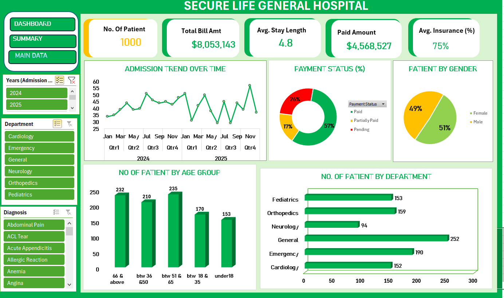

# Ms-excel-dashboard-project

## INTRODUCTION

The secure life hospital performance dashboard was created to analyze the hospital patient records and financial information using Microsoft Excel. This dashboard focuses on understanding patient demographics, hospital department performance, medical diagnoses, billing patterns, insurance coverage and payment status.
The aim of this project is to transform raw hospital data into meaningful insights that can support better decision-making, resource allocation and financial monitoring.
The final output is an interactive dashboard that provides clear overview and key performance indicators/ trends in a simple format.

## ABOUT THE DATASET

The dataset consists of 1,000 hospital patient records and 11 columns containing patient demographic details, admission and discharge dates, hospital departments, medical diagnoses, billing information, insurance coverage percentages and payment statuses.
The data covers admission dates from January 2024 to December 2025. It can be used to analyze patient distribution, department workload, length of hospital stay, billing patterns, insurance coverage and payment status.
An initial data quality check found no missing values in the dataset. Further checks can be conducted to verify duplicate records, data consistency and the accuracy of dates and numerical values. Kindly find attached secure life hospital dataset.

## PROBLEM STATEMENT

The Hospital management needs clear and reliable information about patient admissions, departmental workload and financial performance to make informed decisions. However, raw patient records can make it difficult to identify patterns, compare departments and monitor billing and payment statuses efficiently.
This project addresses the need for a visual reporting tool that summarises patient demographics, hospital department performance, medical diagnoses, billing amounts, insurance coverage and payment statuses. The dashboard is designed to help users identify important trends, understand the distribution of hospital activities and support informed operational and financial decisions.
Insights and Findings

The analysis revealed several important findings about hospital operations and financial performance.
- Patient demographics: Female patients accounted for 51.2% of the records, while male patients accounted for 48.8%.
- Department distribution: The General department recorded the highest number of patients, with 252 records, whereas Neurology recorded the lowest, with 94.
- Financial performance: The total recorded bill amount was approximately 8.05 million in the dataset's unspecified currency units. Orthopedics contributed the highest departmental bill total.
- Payment status: A total of 564 records were marked Paid, while 257 were Pending and 179 were Partially Paid. These findings highlight the importance of monitoring outstanding payment statuses.
- Length of stay: The average patient stay was approximately 4.8 days, with stays ranging from 1 to 14 days.

## Visualization

## Insights and Findings

The analysis revealed several important findings about hospital operations and financial performance.
- Patient demographics: Female patients accounted for 51.2% of the records, while male patients accounted for 48.8%.
- Department distribution: The General department recorded the highest number of patients, with 252 records, whereas Neurology recorded the lowest, with 94.
- Financial performance: The total recorded bill amount was approximately 8.05 million in the dataset's unspecified currency units. Orthopedics contributed the highest departmental bill total.
- Payment status: A total of 564 records were marked Paid, while 257 were Pending and 179 were Partially Paid. These findings highlight the importance of monitoring outstanding payment statuses.
- Length of stay: The average patient stay was approximately 4.8 days,with stays ranging from 1 to 14 days.

 ## Recommendations
Improve departmental resource.
Strengthen financial monitoring.
Monitor patient length of stay.
Use dashboards for regular reporting.
Maintain accurate patient records.
Monitor departmental billing patterns.

## conclusion 
The findings showed that the General department recorded the highest number of patients, Orthopedics had the highest total bill amount, and 436 patient records were marked as Pending or Partially Paid.
The dashboard provides a practical way to summarise hospital data, identify patterns and support monitoring of hospital activities. It can assist management in making informed decisions regarding resource allocation, financial monitoring and operational planning.

in conclusion the project highlights the value of data analysis and visualization in transforming raw data into meaningful information. Regular updates and accurate record-keeping will be essential to maintaining the usefulness of the dashboard.
